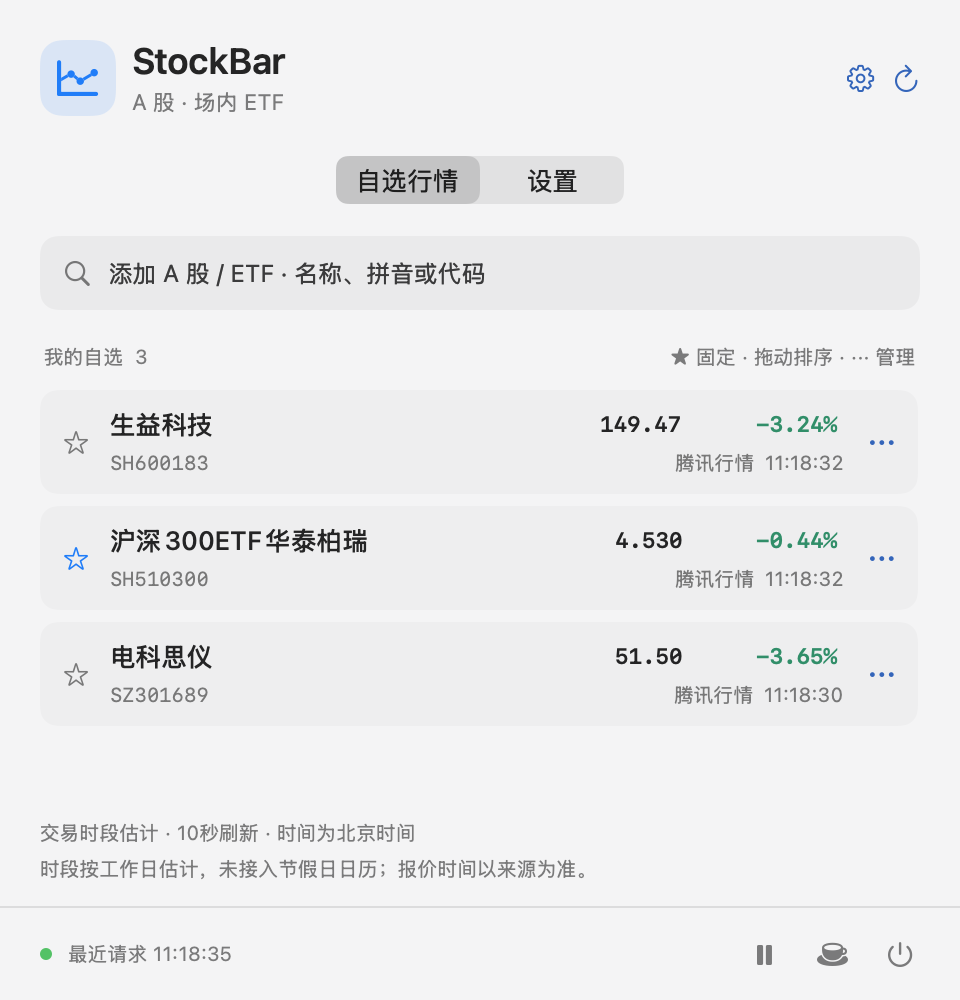
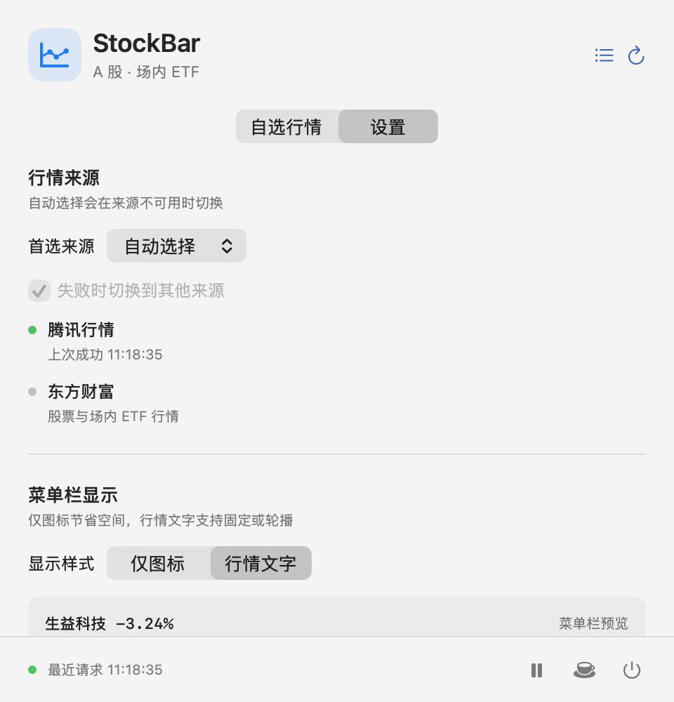

<div align="center">
  
  <h1>StockBar</h1>
  <p><strong>在 Mac 菜单栏快速查看 A 股与场内 ETF 行情</strong></p>
  <p>Native macOS menu bar stock ticker for China A-shares and ETFs.</p>
</div>

[](https://github.com/zhdaniel/StockBar/actions/workflows/build-release.yml)
[](https://github.com/zhdaniel/StockBar/releases/latest)
[](https://github.com/zhdaniel/StockBar)

StockBar 是一款轻量的原生 macOS 菜单栏行情工具。它支持沪深 A 股与场内 ETF、自选轮播、腾讯与东方财富双行情源，以及 macOS 26 Liquid Glass。应用不包含交易或账户功能，自选和设置只保存在本机。

## 界面预览

<table>
  <tr>
    <td width="50%"></td>
    <td width="50%"></td>
  </tr>
  <tr>
    <td align="center">自选行情、价格、涨跌幅与数据来源</td>
    <td align="center">行情源状态与菜单栏显示样式</td>
  </tr>
</table>

## 下载与安装

1. 从 [GitHub Releases](https://github.com/zhdaniel/StockBar/releases/latest) 下载最新的 `StockBar-*-macOS-arm64.zip`。
2. 解压后，将 `StockBar.app` 拖入「应用程序」。
3. 启动 StockBar，点击菜单栏中的行情文字或图标打开面板。

当前版本仅提供 Apple Silicon 构建，最低支持 macOS 13。安装包已做 ad-hoc 签名，尚未使用 Developer ID 签名和 Apple 公证；测试期间如 macOS 阻止首次启动，可在 Finder 中右键应用并选择「打开」。不要关闭系统 Gatekeeper。

## 三步开始使用

1. **添加自选**：输入名称、拼音或六位证券代码，选择搜索结果中的「添加」。
2. **设置菜单栏**：点击星标固定证券，或在「设置 → 菜单栏显示」启用自选轮播。
3. **选择行情源**：默认自动选择腾讯行情，并在异常时切换东方财富；也可手动指定来源。

菜单栏末尾出现 `·` 表示报价可能是旧值或仍在更新。行情时间采用北京时间，交易时段按工作日估计，暂未接入节假日日历。

## 主要功能

- 原生 macOS 菜单栏股票行情：支持仅图标、固定行情文字和自选轮播。
- A 股与场内 ETF 自选列表：按名称、拼音或证券代码搜索并排序。
- 可插拔行情数据源：内置腾讯行情与东方财富，支持自动切换、失败退避和旧值标记。
- SwiftUI + AppKit 原生界面：macOS 26 使用 Liquid Glass，macOS 13–15 自动使用传统毛玻璃。
- 本地优先：自选和设置只保存在本机，不包含交易、下单、云同步或遥测。
- Apple Silicon 自动构建：GitHub Releases 提供经过测试的 arm64 ZIP 和 SHA-256 校验文件。

## 使用说明

- 输入名称、拼音或六位代码搜索；东方财富提供代码搜索，腾讯提供名称/拼音搜索。
- 点星标固定主标的；拖动行排序；行尾菜单移除自选。最多50个。
- 「设置 → 行情来源」支持自动、腾讯、东方财富。手动指定来源时可关闭自动回退。
- 「设置 → 菜单栏显示 → 显示样式」支持“仅图标”和“行情文字”。仅图标占用一个标准菜单栏图标位置，点击仍打开自选；图标自动适应系统明暗主题。
- 图标模式暂停文字轮播，保留原有配置；切回行情文字后恢复原来的固定/轮播、字号与显示内容。旧配置默认保持行情文字。
- 行情文字可选：简称 / 代码 / 不显示名称；涨跌幅 / 价格 / 价格+涨跌幅。
- 最大宽度120/180/240 pt，字号11/12/13；空间不足先缩短名称并标省略号，再必要时缩小字号，优先保留数值。
- 轮播间隔5/8/15/30秒，支持单色、红绿配色、登录时启动。
- 紧凑面板、每行来源显示可配置；外观重置保留自选和行情源。
- 「设置 → 面板外观 → 毛玻璃效果」默认启用。macOS 26+ 使用原生 Liquid Glass，macOS 13–15 使用 NSVisualEffectView 传统毛玻璃；关闭时使用纯色背景。
- 遵循系统减少透明度、增强对比度设置，自动使用清晰背景。切换材质保留设置页滚动位置和输入控件状态。
- 弹窗根据屏幕可用高度缩放；列表和设置分别滚动，底部工具栏固定。行尾菜单提供上移/下移/移除。
- 底部可暂停/恢复自动刷新，暂停时仍可手动刷新。
- 首次启动带三个示例自选，均可移除；没有交易、下单或账户接入功能。
- 默认10秒刷新，最低10秒；休市估计时段5分钟刷新。手动刷新也有5秒下限。
- 收起弹窗只请求主标的；轮播时请求整个自选列表。展开后刷新列表。
- `·` 出现在菜单栏末尾时表示旧值/待更新，弹窗提供时间与来源。
- 行情时间为北京时间。按工作日和时段估计交易状态，未接入节假日日历。正常收盘保留收盘报价，网络失败保留旧值，缺失值不会显示为0。

配置与缓存位于 `~/Library/Application Support/StockBar/state.json`，原子写入；无云同步和遥测。上游仍会接收行情查询代码和搜索词。

建议将应用复制到「应用程序」并固定路径后，再启用登录时启动。若系统要求，在「系统设置 → 通用 → 登录项」允许启动。

## 常见问题

**为什么菜单栏只显示图标？**<br>
在「设置 → 菜单栏显示」中选择「行情文字」。仅图标模式适合菜单栏空间较少的设备。

**为什么价格没有更新？**<br>
检查面板底部状态和每行的数据来源。StockBar 会自动尝试备用来源；休市期间自动降低刷新频率，手动刷新至少间隔 5 秒。

**StockBar 可以交易或读取持仓吗？**<br>
不可以。StockBar 只展示行情，不连接券商账户，不执行交易，也不上传自选列表。

**如何退出或暂停刷新？**<br>
面板右下角依次提供暂停/继续、支持作者和退出图标，悬停图标可查看说明。

## 构建和测试

构建需要 Xcode 26 或更新版本（macOS 26 SDK）；应用运行最低仍为 macOS 13，新的材质 API 有系统版本保护。

```bash
cd StockBar
swift test
./scripts/build-app.sh
open dist/StockBar.app
```

构建脚本可用 `STOCKBAR_BUILD_PATH` 指定中间产物目录，默认 `.build`。诊断入口：

```bash
# 两个原生 Provider 各查询一次三个示例标的，输出到终端。
dist/StockBar.app/Contents/MacOS/StockBar --smoke-test
# 以独立窗口验证同一套面板UI，正常使用不要加此参数。
open dist/StockBar.app --args --qa-window
```

## 可插拔来源设计

这里的“可插拔”是应用内部的 Swift Provider 插件协议：可独立增加、替换、测试实现，再重新构建。当前不加载第三方动态代码，也没有任意 URL 脚本插件机制。

```
菜单栏 / SwiftUI 面板
         ↓
      AppStore            缓存、持久化、刷新、睡眠唤醒
         ↓
      QuoteEngine         优先顺序、逐标的补查、冷却、最新报价选择
         ↓
    ProviderRegistry
       ├─ TencentProvider       GB18030 / 文本协议
       └─ EastmoneyProvider     JSON / 双域名容错
         ↓
      HTTPTransport       URLSession；测试时替换为 stub
```

新增来源：

1. 在 `Sources/StockBarCore` 新增实现 `QuoteProvider` 的类型。
2. 提供唯一 `ProviderDescriptor.id`，实现 `fetch` 和 `search`。
3. 在 `ProviderRegistry.standard()` 中注册实例。默认顺序决定自动模式优先级，设置页面自动列出来源，无需修改UI。
4. 添加响应样本、解析测试和 Provider 专有错误场景测试。

接口约定：

- `fetch` 返回 `[instrumentID: Quote]`；不要把不可用字段转成0，未知标的可不返回。
- `Quote` 使用 Decimal，保留 ETF 三位小数；报价时间和接收时间分开。
- `sourceID` 必须与注册ID一致；金额单位和涨跌百分比需归一化。
- 当前 Instrument 覆盖沪深。扩展港美股需要一并扩展代码映射、币种、时区和市场日历，不能仅加URL。
- 搜索返回受支持市场的 Instrument；不执行上游 JS 或 JSONP。
- 所有网络都允许取消。搜索防抖400ms，行情请求不重叠。

切换规则：主源异常、部分标的缺失或工作日交易时段报价超过120秒时，尝试后续来源。仅补查缺失/旧报价；保留同一标的时间较新的结果。连续失败两次进入30秒冷却，后续失败指数增加，最多5分钟。手动切源清除冷却；取消请求不触发回退。两个来源都不可用时保留缓存并标旧。

东方财富内部先请求 `push2delay`，失败后请求 `push2`；两者是同一 Provider 的传输备选，不会冒充两个独立供应商。默认腾讯为主；不使用原扩展作者的代理或账户服务。

## 源文件

- `Models.swift`：证券、报价、Provider协议、行情时段与数值解析。
- `Preferences.swift`：可持久化配置，兼容旧配置缺失字段。
- `Providers.swift`：可注入网络层、腾讯与东方财富、注册表。
- `QuoteEngine.swift`：与供应商无关的自动切换和健康状态。
- `AppStore.swift`：应用状态、缓存、调度、自选和搜索。
- `PanelView.swift`：自选和设置。
- `GlassAppearance.swift`：Liquid Glass、旧版毛玻璃和辅助功能降级。
- `main.swift`：菜单栏、弹窗、生命周期与诊断入口。

## 当前边界

本版完成计划中的基础 MVP，不包含分时图、完整K线、持仓、预警、港美股、场外基金或云同步。接口为上游网站接口，无稳定性保证；发布给其他用户前需确认供应商使用条件。完整交易日、节假日、真实睡眠唤醒以及登录启动需要更长的实际使用验收，不能用快速测试替代。

## v0.3 材质实现

面板使用单层玻璃背景，行情行只做轻量半透明分隔，避免多层玻璃叠加影响数字可读性。采用 Apple 原生 [glassEffect](https://developer.apple.com/documentation/swiftui/view/glasseffect(_:in:))，系统动态调整材质；没有叠加自制模糊滤镜。

### 0.5.1

- 暂停刘海行情功能，移除设置入口和悬浮窗口；旧配置不会重新开启它。
- 新增应用图标，显示于 Finder、启动台及应用信息中。菜单栏继续使用适配深浅色的单色图标。
- 弹出面板采用独立窗口，打开时定位并约束在屏幕内；Escape、再次点击菜单栏按钮或点击其他应用可关闭。

## 自动构建与发布

[Build and Release](https://github.com/zhdaniel/StockBar/actions/workflows/build-release.yml) 在 `main` 提交、PR 和手动运行时执行单元测试、构建 Apple Silicon 应用、校验签名并上传 ZIP 与 SHA-256 校验文件。可在对应 Actions 运行页下载产物，保留 14 天。

推送 `v主版本.次版本.补丁版本` 标签会在构建成功后自动发布到 [GitHub Releases](https://github.com/zhdaniel/StockBar/releases)。标签必须与 `VERSION` 文件一致；未通过测试或版本校验不会发布。流程先创建草稿，附件上传完成后才正式发布；重新运行不会覆盖已发布版本。

发布新版本示例：

```bash
# 先修改 VERSION 和 CHANGELOG.md，并提交到 main
printf '0.5.7\n' > VERSION
git add VERSION CHANGELOG.md
git commit -m "Release 0.5.7"
git push origin main
git tag -a v0.5.7 -m "StockBar v0.5.7"
git push origin v0.5.7
```

只需 GitHub 自动提供的 `GITHUB_TOKEN`，无需添加个人令牌。私有仓库的产物与 Releases 也仅对有访问权限的用户开放。当前使用 ad-hoc 签名，未配置 Developer ID 签名或公证。

底部咖啡杯图标可打开微信二维码浮层，悬停可查看按钮说明；点击关闭按钮、背景或按 Escape 关闭。应用仅展示静态图片，不会发起付款或收集支付信息。
